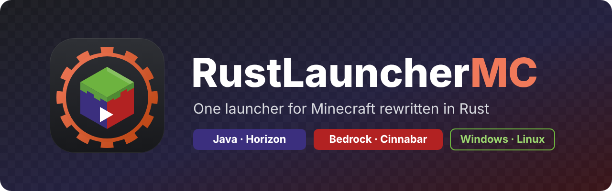

<p align="center">
  
</p>

<p align="center">
  <a href="https://github.com/RustLauncherMC/Launcher/releases/latest"></a>
  <a href="https://github.com/RustLauncherMC/Launcher/actions/workflows/ci.yml"></a>
  
  
  <a href="LICENSE"></a>
</p>

<p align="center">
  <a href="https://rustlaunchermc.github.io/Launcher/"><b>Website</b></a> ·
  <a href="#download"><b>Download</b></a> ·
  <a href="#getting-started"><b>Getting started</b></a> ·
  <a href="#building-from-source"><b>Building</b></a> ·
  <a href="https://github.com/RustLauncherMC/Launcher/issues"><b>Issues</b></a>
</p>

# RustLauncherMC

**One launcher for both Rust editions of Minecraft.** RustLauncherMC installs, updates and starts
[Horizon](https://github.com/horizon-rust/horizon) (Minecraft: Java Edition, rewritten in Rust) and
[Cinnabar](https://github.com/cinnabar-mc/cinnabar) (a Minecraft: Bedrock Edition client written in
Rust) from one window, laid out like the official Minecraft Launcher.

> [!IMPORTANT]
> RustLauncherMC is a **fan project**. It is not an official Minecraft product and is not
> approved by or associated with Mojang or Microsoft. It is also not affiliated with the Horizon
> or Cinnabar projects. Minecraft is a trademark of Microsoft Corporation. The launcher ships no
> Minecraft code, assets or data.

## Status

**v0.1.0 is out** for Windows and Linux.

| | Status |
| --- | --- |
| **Bedrock Edition** (Cinnabar) | Works: install, update, launch, installations, Join a server. Cinnabar signs you in inside the game. |
| **Java Edition** (Horizon) | Install, prepare and launch work. **Microsoft sign-in is waiting for Mojang** to approve the launcher's sign-in app; until then, Minecraft refuses the last sign-in step. |
| **The launcher** | Signed releases, installers and self-update are in place. |

## Download

| System | File | Updates itself |
| --- | --- | --- |
| **Windows 10 and 11** (64-bit) | [**RustLauncherMC-Setup-x64.exe**](https://github.com/RustLauncherMC/Launcher/releases/latest/download/RustLauncherMC-Setup-x64.exe): installer, no administrator needed | Yes |
| | [rustlauncher-windows-x64.zip](https://github.com/RustLauncherMC/Launcher/releases/latest/download/rustlauncher-windows-x64.zip): portable | Yes |
| **Linux** (x86-64, glibc 2.35+) | [**RustLauncherMC-x86_64.AppImage**](https://github.com/RustLauncherMC/Launcher/releases/latest/download/RustLauncherMC-x86_64.AppImage): most distributions | Yes |
| | `rustlaunchermc_<version>_amd64.deb` from the [releases page](https://github.com/RustLauncherMC/Launcher/releases/latest): Debian, Ubuntu 22.04 and newer | Install the newer `.deb` |
| | [rustlauncher-linux-x86_64.tar.gz](https://github.com/RustLauncherMC/Launcher/releases/latest/download/rustlauncher-linux-x86_64.tar.gz): plain binary | Yes |

Every release has a `SHA256SUMS` file, signed with the project's key. To check a download,
put `SHA256SUMS` next to it and run:

```sh
sha256sum --ignore-missing -c SHA256SUMS
```

Windows may show a SmartScreen warning, because the launcher isn't code-signed yet: choose
**More info → Run anyway**. macOS isn't supported.

## Getting started

1. **Install it.**
   - **Windows:** run the installer. RustLauncherMC appears in the Start menu.
   - **AppImage:** `chmod +x RustLauncherMC-x86_64.AppImage`, then run it.
   - **.deb:** `sudo apt install ./rustlaunchermc_*_amd64.deb`. RustLauncherMC appears in your
     applications menu.
2. **Pick an edition** in the sidebar.
   - **Bedrock:** press **Install**, then **Play**. The first time, Cinnabar asks you to accept
     the Minecraft EULA and to sign in with Microsoft.
   - **Java:** sign in with a Microsoft account that owns Minecraft: Java Edition, then press
     **Install**. The first start downloads Horizon and prepares its files from your copy of
     Minecraft 26.3, which takes a few minutes.
3. **Press Play.**

### What you need

| | Java: Horizon | Bedrock: Cinnabar |
| --- | --- | --- |
| **Account** | A Microsoft account that owns Minecraft: Java Edition (Game Pass works) | A Microsoft account |
| **Game files** | Your own Java Edition 26.3: the copy in the official launcher's folder, or downloaded from Mojang for your account. Java 25 is downloaded if you don't have it | Downloaded by Cinnabar after you accept the Minecraft EULA |
| **Graphics** | Vulkan or OpenGL 3.3 (Linux), Vulkan or DirectX 12 (Windows) | Vulkan or DirectX 12 |
| **Linux only** | A password store (GNOME Keyring or KWallet) for the Java sign-in | |

Each game's own README is the source of truth for its requirements.

## Features

- **Familiar layout:** editions in a sidebar; Play, Installations, Logs and Patch notes tabs; and a big
  green Play button with the installation picker beside it.
- **Bedrock through Cinnabar:**
  - Finds a copy you already installed, or installs the official Beta or Nightly, checked
    against the release's SHA-256 sums.
  - On Linux it uses Cinnabar's own install layout, so Cinnabar's updater keeps working. On
    Windows it runs the official installer.
- **Java through Horizon:** Play does what Horizon's own launcher does before a start:
  - Checks that your account owns Java Edition.
  - Installs or updates to the newest nightly, checked against Horizon's signed checksums.
  - Prepares the game files from your copy of Minecraft, checking each file.
  - Starts the game through Horizon's Launch API with your account.
  - Points you to the crash report if the game crashes.
- **Logs and crash reports:** the Logs tab lists each installation's logs and crash reports,
  newest crash first, with errors and warnings coloured, and Copy and Open folder buttons. When a
  game crashes, the bottom bar links straight to its report.
- **Microsoft sign-in** with a short code at microsoft.com/link. Tokens are kept only in your
  system's password storage (Windows Credential Manager, or GNOME Keyring or KWallet on Linux).
- **Installations:** several per edition, each with its own worlds and settings. Java ones can
  open fullscreen.
- **Join a server:** type an address on the Play tab, and the game joins it as it starts.
- **Player heads** for your Java accounts.
- **Self-update:** new versions install with one click, and only when they're signed with the
  project's key.

## FAQ

**Is this official?** No. It's a fan project, not affiliated with Mojang, Microsoft, Horizon or
Cinnabar.

**Why does Java sign-in say the app isn't approved?** Minecraft only lets apps that Mojang has
approved sign players in, and RustLauncherMC's app is still in review. Bedrock isn't affected.

**Can servers ban me?** Cinnabar's README warns that its movement and combat may not match the
official client yet, so some anticheats may flag it. Play on servers at your own risk.

**Where are my files?**

| | Windows | Linux |
| --- | --- | --- |
| Launcher settings and accounts list | `%APPDATA%\RustLauncherMC` | `~/.config/rustlaunchermc` |
| Horizon: builds, worlds, logs (also in the Logs tab) | `%LOCALAPPDATA%\RustLauncherMC\horizon` | `~/.local/share/rustlaunchermc/horizon` |
| Cinnabar (Default installation) | `%LOCALAPPDATA%\Cinnabar` | `~/.local/share/cinnabar` |

Each installation's folder is also one click away in the Installations tab.

## Building from source

You need a recent stable Rust (tested with 1.97). Install it with [rustup](https://rustup.rs),
because some distributions package an older `cargo` that's too old:

```sh
curl --proto '=https' --tlsv1.2 -sSf https://sh.rustup.rs | sh
```

On Debian and Ubuntu, also install a C compiler and GPUI's libraries:

```sh
sudo apt install build-essential pkg-config \
  libxkbcommon-x11-dev libwayland-dev libx11-xcb-dev libfontconfig-dev libvulkan-dev
```

Then:

```sh
git clone https://github.com/RustLauncherMC/Launcher.git
cd Launcher
cargo run --release
```

`cargo test --workspace` runs the tests.

| Crate | What it is |
| --- | --- |
| [`crates/rlmc-core`](crates/rlmc-core) | The backend, with no UI: releases and verified downloads, Microsoft sign-in and accounts, Horizon's install, preparation and launch, Cinnabar's install and launch, installations, logs and crash reports, settings, self-update |
| [`crates/rlmc`](crates/rlmc) | The GPUI app (the `rustlauncher` binary) |
| [`crates/rlmc-release`](crates/rlmc-release) | Signs releases ([docs/releasing.md](docs/releasing.md)) |

Settings for development:

| Variable | What it does |
| --- | --- |
| `RUSTLAUNCHERMC_HOME=/absolute/folder` | Keeps the launcher's settings, data and downloads in that folder |
| `RUSTLAUNCHERMC_MSA_CLIENT_ID=<id>` | Uses another Azure app for the Microsoft sign-in, to test your own |
| `RUSTLAUNCHERMC_NO_SELF_UPDATE=1` | Turns self-update off |

## Documentation

- [docs/upstream-research.md](docs/upstream-research.md): how Horizon and Cinnabar are installed,
  signed in and started, and the decisions behind the launcher.
- [docs/releasing.md](docs/releasing.md): making a release, and the signing key.
- [website/README.md](website/README.md): the website, its SEO and its social image.

## Roadmap

- [x] Launcher window in the official launcher's layout
- [x] Cinnabar: install, update, launch, patch notes
- [x] Horizon: install, prepare, launch, crash reports
- [x] Microsoft sign-in
- [x] Installations, Join a server, player heads
- [x] Signed releases, installers, self-update
- [x] First release (v0.1.0) and the website
- [ ] Mojang's approval of the sign-in app
- [x] Log and crash viewer in the launcher
- [ ] More options per installation (window size, game arguments)
- [ ] Translations
- [ ] Flatpak

## Contributing

Ideas, bug reports and pull requests are welcome. Please open an issue first for larger changes, so
we can agree on the approach. Before a pull request, run:

```sh
cargo fmt --all
cargo clippy --workspace --all-targets -- -D warnings
cargo test --workspace
```

## Branding

The logo is in [`assets/`](assets): `logo.svg` (source), `logo-256.png`, `logo-512.png`,
`logo.ico`, and the banner (`banner.svg`, `banner.png`). It shows a block with a Java side
(Horizon purple), a Bedrock side (Cinnabar red) and a play button, inside a Rust-orange cog. It
uses no Mojang or Microsoft artwork.

## License

[MIT](LICENSE). Bundled third-party parts are listed in
[THIRD_PARTY_NOTICES.md](THIRD_PARTY_NOTICES.md).

Horizon (MIT) and Cinnabar (PolyForm Noncommercial 1.0.0) are separate projects under their own
licenses. The launcher downloads them from their official releases and doesn't bundle them.
Because of Cinnabar's license, RustLauncherMC is and stays noncommercial.
